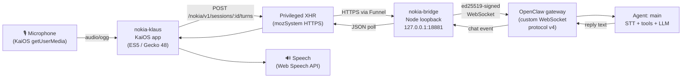

<div align="center">

# nokia-voice-openclaw-gateway

**Voice assistant on a Nokia KaiOS phone via a custom OpenClaw gateway bridge**

[](LICENSE)
[](https://nodejs.org)
[](docs/compatibility.md)
[](#compatibility)

*Personal experiment — not certified, not production-ready.*

</div>

---

**[Quickstart](#quickstart)** · **[Controls](#controls)** · **[Architecture](#architecture)** · **[Security](#security)** · **[Docs](#docs)**

---

## What this is

A loopback bridge server and two KaiOS phone apps that turn a Nokia 6300 4G into a voice terminal for an OpenClaw-hosted AI assistant. The phone records audio and sends it over HTTPS to the bridge; a dedicated signed backend device forwards it to the existing gateway. Replies return as text and local speech.

Components:

| Component | Path | Purpose |
|---|---|---|
| `nokia-bridge` | `configs/nokia-bridge/` | Node.js loopback server — translates phone HTTP into signed WebSocket gateway calls |
| `nokia-klaus` | `configs/nokia-klaus/` | KaiOS chat app: talk or type, chat bubbles, TTS |
| `nokia-launcher` | `configs/nokia-launcher/` | KaiOS launcher — quick access to Klaus, Phone, SMS |
| `nokia-notes` | `configs/nokia-notes/` | Optional quick-note inbox: phone notes to dated Markdown files (WhisperX transcription) |

## Quickstart

```sh
# 1. Install dependencies (ws runtime + TypeScript dev tools)
npm ci

# 2. Build the bridge and both offline phone packages
npm run build

# 3. Run offline tests (no phone or gateway needed)
npm test

# 4. Read the setup guide before provisioning credentials
```

See [docs/setup.md](docs/setup.md) for full setup including provisioning, pairing, and phone package building.

## Controls

Key bindings on the KaiOS voice app (`nokia-klaus`). The softkey bar always shows the current labels; full table in [configs/nokia-klaus/README.md](configs/nokia-klaus/README.md).

| Key | Action |
|---|---|
| **Centre** (OK) | Start recording; again to pause / resume |
| **Call** (green) | Send the clip or typed text (SoftRight also sends while paused) |
| **Backspace** (recording) | Discard the clip (asks twice over 3 s) |
| **SoftLeft** | Type a message (Enter or Call sends) |
| **SoftRight** | Menu: New chat, Rename, Archive, Retry last, Read aloud on/off |
| **↑** / **↓** | Focus previous / next message |
| **←** / **→**, **4** / **6** | Switch chat |
| **1** / **9** | Oldest / newest message |
| **2** / **8** | Page up / down |
| **5** | Read the focused (or latest) reply aloud |
| **0** | Toggle auto read-aloud |
| **#** | Chat list |
| **3** / **7** | New chat / archive chat (with confirm) |
| **\*** | Notes screen: voice/typed notes to the quick-note inbox |
| **Backspace** | Cancel the pending request or unsent clip; otherwise exits |

Key bindings on the launcher (`nokia-launcher`):

| Key | Action |
|---|---|
| **1** | Open Klaus voice app |
| **2** | Open Phone (dial activity) |
| **3** | Open SMS |
| **↑** / **↓** | Navigate |
| **Enter** / SoftLeft (Select) | Launch selected app |

## Architecture



**Data flow:** Microphone → privileged KaiOS XHR (HTTPS) → loopback bridge → dedicated signed backend device → existing OpenClaw agent (STT / tools) → reply text → TTS.

## Compatibility

**Hardware verified: Nokia 6300 4G TA-1287, using its stock KaiOS/Gecko 48 environment. Other devices, including the 8110, are untested.**

- Backend integration was verified against a customized OpenClaw protocol-v4 deployment; compatibility with other versions is unverified.
- Six local speech voices were found, including English, French, German, Spanish and Italian; no Danish voice was available on the tested phone.
- The app-blocking policy (`nokia-policy.py`) is reversible development tooling, **not** proven strict kiosk enforcement.
- Boot/firmware patching tools and stock firmware are intentionally excluded.
- Audio transcription and replies worked on the test deployment. Email and other identity-sensitive tool capability parity remain unverified.

See [docs/compatibility.md](docs/compatibility.md) for full details.

## Security

The handset bearer authorizes only this bridge’s session API; it is **not** a gateway credential. A stolen token permits use of that handset’s conversations and assistant capabilities until revoked. The server-side signed device has broader gateway `operator.read`/`operator.write` scopes, so compromise of the bridge host or signing key is a separate, more powerful threat. HTTPS may share a host with other services; this project does not secure those routes.

Key points:
- Bearer token is **plain-text** inside the phone package zip — treat it as a device credential
- Provisioning reloads on every authenticated request — revoke by emptying `tokenHashes`
- Private files must be mode 0600 / directory mode 0700, outside the repository
- Separate audit required before adding additional Funnel routes

See [docs/security.md](docs/security.md) for the full threat model.

## Docs

- [Setup and deployment](docs/setup.md)
- [Security notes](docs/security.md)
- [Compatibility and limitations](docs/compatibility.md)
- [Bridge HTTP contract](configs/nokia-bridge/README.md)
- [Voice app](configs/nokia-klaus/README.md)
- [Launcher app](configs/nokia-launcher/README.md)

## Acknowledgements

The handset UI’s dark teal and mint palette was inspired by EcoRay’s visual identity. The original app header retains the **ECORAY / KLAUS** label. This is Lucas Hanson’s personal open-source project, not an official EcoRay product or a claim of company endorsement.

## License

[MIT](LICENSE) © 2026 Lucas Hanson

See [THIRD_PARTY_NOTICES.md](THIRD_PARTY_NOTICES.md) for dependency licenses.
